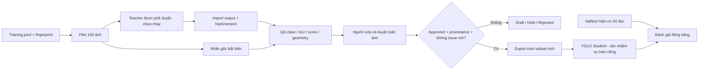

# Teacher–Student annotation pipeline — Task 03A

## Phạm vi

`scripts/teacher_student/` là công cụ cục bộ tách khỏi app/API/database sản phẩm.
Không train, tải model/dataset, gọi API ngoài hoặc tự approve. Các task 01/02A/02B
giữ nguyên. Chín object groups phải khớp YAML hiện tại; không đổi taxonomy phục vụ.



Không có Teacher vẫn mở được review nhãn gốc; UI ghi rõ Teacher chưa có, không
vẽ box/score giả. Toàn bộ real pilot hiện pending; không có dữ liệu mới đủ gate training.

## Adapter Teacher local — đã viết, chưa smoke model thật

`local_teacher.py` có adapter Grounding DINO HF. CLI `teacher-status` chỉ kiểm
dependency; `propose-local` chỉ nạp thư mục local đã pin, `local_files_only=True`,
`trust_remote_code=False`, safetensors-only. Chặn socket connection và bật offline
environment trong process CLI; không có đường download, API cloud hoặc auto-install.
CPU mặc định; CUDA phải chọn rõ. Cần smoke thật sau khi được duyệt artifact/env;
unit tests không chứng minh adapter tương thích runtime/model chưa cài.

Artifact tương lai phải là folder riêng chứa file thật (không symlink ra ngoài):
`teacher_artifact.json` ghi model_id, revision và authorization_reference thực,
`files` map mọi filename -> SHA-256. Model/revision/weights phải khớp pin trong
`TEACHER_RESEARCH.md`; bắt buộc config.json, model.safetensors,
preprocessor_config.json, tokenizer_config.json và tokenizer.json hoặc vocab.txt.
Chỉ JSON/TXT/safetensors được phép; không `.py`, pickle/bin hoặc file ngoài manifest.
Không tạo artifact/receipt duyệt giả trong Task 03A.

Sau phê duyệt và có artifact thật mới dùng, thay đường dẫn mẫu phù hợp:

```powershell
backend\.venv\Scripts\python.exe -m scripts.teacher_student teacher-status
backend\.venv\Scripts\python.exe -m scripts.teacher_student propose-local --workspace data/teacher_student/task03a_pilot150 --artifact data/teacher_student/teacher_artifacts/grounding_dino_tiny --output data/teacher_student/proposals/dino_smoke_v1.json --limit 5 --device cpu
```

Adapter chỉ lấy IDs train đã vào pilot, giữ hash/snapshot trước và sau, không nạp
Student làm Teacher. Prompt map cụ thể theo `TEACHER_PROMPT.md`; phrase ngoài bảng
giữ unknown. Box được clip vào ảnh có giữ raw_box/box_adjustment; box native
degenerate/outside hoàn toàn lưu riêng rejected_native_proposals, không dùng làm
training label. Lỗi model/output không biến thành kết quả không detection.
Bundle ghi actual score, latency, versions, device và peak CUDA memory nếu dùng GPU;
chưa import hay approve tự động. Output chỉ tạo sau khi mọi inference đã hoàn tất.
Hiện `teacher-status` báo thiếu Transformers; preflight artifact thiếu trả exit2,
không tạo output. **Không có Teacher inference thật trong Task 03A.**

## Audit và split isolation

- Quét ảnh/YOLO labels, counts theo class/source/split, SHA file và pixel, source
  hash, grouping cùng nguồn gốc (TACO mirror/reserved cùng namespace), dHash≤8.
- Đối chiếu labels với annotation TACO đã pin và WaRP trong archive; kiểm raw-image
  checksums/cache. “Khớp nguồn” không chứng minh đúng ngữ nghĩa hoặc không bỏ sót.
- Tiny: cạnh<3 px hoặc area<16 px². Extreme: aspect ratio>20 hoặc area>90% ảnh.
  IoU≥0.95 gắn cờ duplicate/conflicting candidate; không tự sửa nhãn.
- dHash là heuristic; không tuyên bố leakage chỉ vì ảnh gần giống. Pilot loại các
  train IDs trùng identity/group qua split và cả near-cross-split candidates để review riêng.
- Snapshot gồm YAML/manifest/metadata và mọi image/label TXT hiện có, cả orphan;
  phát hiện thêm ảnh eval sau audit. Pilot/export từ chối source đổi fingerprint.
- 150 ảnh được chọn có seed 42, quota HF TACO80/WaRP55/Street15, rare-class coverage,
  density/tiny boxes và scene diversity. Đây là heuristic “mẫu khó”, chưa phải
  lỗi đã được Teacher hoặc người xác nhận. Không sửa/re-split file nguồn.

## Thao tác

Chạy từ repo root, venv hiện có. Các output phải mới, không ghi đè workspace/dataset.

```powershell
backend\.venv\Scripts\python.exe -m scripts.teacher_student audit --dataset data/processed/waste_multisource_v3 --repo . --output logs/task03a/dataset_audit_next.json
backend\.venv\Scripts\python.exe -m scripts.teacher_student pilot --audit logs/task03a/dataset_audit_final.json --workspace data/teacher_student/new_pilot150 --count 150 --seed 42
backend\.venv\Scripts\python.exe -m scripts.teacher_student serve --workspace data/teacher_student/task03a_pilot150 --port 8013
```

Pilot **đã có**: `data/teacher_student/task03a_pilot150/`; không chạy lại lệnh pilot
vào đường dẫn đó. Mở `http://127.0.0.1:8013`. Nếu cổng bận kiểm đúng process, không
dừng server lạ. Chỉ bind loopback; không public tool có quyền duyệt hoặc ảnh.

Sau khi có output Teacher thật được phê duyệt:

```powershell
backend\.venv\Scripts\python.exe -m scripts.teacher_student import-teacher --workspace data/teacher_student/task03a_pilot150 --bundle <duong-dan-output-teacher-that.json>
```

Đây là **import JSON local**, không thực hiện inference, không gọi nhà cung cấp.
Mọi batch được validate trước khi đổi item. Bundle lặp bị từ chối; bundle mới
tăng revision, hủy approval và giữ draft của người, không tự thay nhãn người.

## Contract Teacher bundle v1

Top-level: `schema_version=1`, `teacher`, `images[]`; không chứa image binary.

| Field | Yêu cầu |
|---|---|
| teacher | model_id, version thực, run_id, generated_at, producer, adapter_version, prompt_sha256, kind, execution_mode, coordinate_space, is_simulated=false |
| kind | grounding_dino / vlm / sam2_assisted |
| execution_mode=local | artifact_sha256 của artifact local thực (weights hoặc manifest artifact đã xác minh), không dùng hash Student |
| execution_mode=external_api_import | authorization_reference, request_id, response_artifact_sha256 và top-level raw_response JSON khớp canonical hash. Không bịa hash weights kín của API |
| coordinate_space | xyxy_pixels_exif_oriented; native normalized/xywh/crop coords phải được adapter chuyển rõ trước import |
| images entry | image_id trong pilot, image_sha256, split=train, width/height chính xác, proposals[] |
| proposal | proposal_id duy nhất trong ảnh, class_id 0..8 hoặc null, class_name khớp mapping nếu có class_id, raw_label, box=[x1,y1,x2,y2], confidence, confidence_kind |
| confidence_kind | detector_score / self_reported_uncalibrated / not_available; không có score thì confidence=null. Nhãn gốc/human không có score |

Unknown phrase giữ `class_id=null`, không auto ép sang `other_litter`. VLM nên dùng
score=null nếu không có score thực. Hash JSON dùng UTF-8, sort_keys=true,
ensure_ascii=false, separators=(',',':'), không NaN; helper `content_hash` là chuẩn.
Các payload trong pytest là fixture lập trình, không phải kết quả model hoặc
nhãn đã duyệt của pilot. Tool không có nút tạo Teacher giả.

## Review

- Bật/tắt box gốc (xanh), Teacher (cam), draft (xanh lá); chọn box hoặc dòng.
  Gốc và Teacher bất biến, sửa chỉ ở draft. Bảng hiển thị class/score/IoU và QA.
- IoU best-match là heuristic many-to-one: flag disagreement khi IoU≥0.5 nhưng
  khác class, potential missed object khi max IoU<0.1, bbox difference ở giữa.
  Source unmatched có thể do Teacher bỏ sót, không được auto xóa source box.
- Sửa class/tọa độ hoặc kéo thêm box; thêm proposal vào draft là thao tác riêng,
  **chưa duyệt**. Chỉnh sửa được trace origin=human, giữ original_index/proposal_id.
- Mark issues sai class/bỏ sót/box/nguy cơ/provenance; unresolved ngăn approve.
  Resolve phải có note. Kiểm toàn ảnh kể cả ngoài box; ảnh nhãn trống cũng cần xem.
- Class chưa ánh xạ (`null`) được giữ trong draft/hold để không ép đoán nhãn;
  approve/export không chấp nhận unknown và không tự đổi thành other_litter.
- Cần reviewer, checklist toàn ảnh/QA/provenance/nguy cơ và căn cứ quyền sử dụng.
  Với nghi pin/y tế/phóng xạ ngoài scope, ưu tiên hold + người chuyên môn, không
  gán nhãn hazard hay an toàn từ 9 class. Checklist là xác nhận của người, không
  thay chuyên môn hoặc xác minh license tự động.
- Revision CAS chặn stale save; file lock chặn writer cạnh tranh. HMAC local gắn
  approval với source/draft/teacher/review/revision; sửa sau duyệt phải duyệt lại.
  Đây là kiểm tính toàn vẹn trong tool local, không phải chữ ký pháp lý hay hệ
  phân quyền chống người có toàn quyền filesystem/key.
- Không chuyển ảnh khi dirty; lưu nháp/hold hoặc dùng nút tải lại có ghi rõ bỏ
  thay đổi chưa lưu. Không có auto-approval hoặc auto-export.
- Workspace test riêng `logs/task03a/ui_smoke_workspace`, test_only=true: có thể
  sửa nháp để kiểm UI, **không thể approve hoặc export training**.

## Export và điều kiện train

Sau người kiểm duyệt thực sự, chạy thủ công:

```powershell
backend\.venv\Scripts\python.exe -m scripts.teacher_student export --workspace data/teacher_student/task03a_pilot150 --output data/teacher_student/exports/approved_v1
```

Chỉ copy ảnh train đã approved, tạo nhãn YOLO và export_manifest có provenance,
teacher version/hash, reviewer/revision/dấu duyệt; không copy draft/pending/hold/rejected.
Val/test YAML trỏ read-only tới split nguồn đóng băng; không copy hoặc sửa nhãn eval.
Kiểm snapshot trước và sau export. Nếu lỗi, giữ chứng cứ `EXPORT_INCOMPLETE.json`,
không phát hành dataset.yaml; không tự xóa output của người dùng. Zero approval
thì không tạo output. Không dùng fallback nhãn chưa duyệt để lấp phần train thiếu.

Task 03A **không có lệnh train tự động**. Chỉ train khi: có nhiệm vụ train riêng,
artifact/env được duyệt, labels người duyệt đủ scope, issues/license/leakage được
xử lý, export hoàn chỉnh và fingerprint còn đúng, config/checkpoint/split/seed
được khóa, có baseline/evaluation plan và quota tài nguyên. Không coi pilot này
là đủ nghiệm thu production.

## Thiết kế so sánh Student

- A0: checkpoint hiện tại `yolo26n_multisource30_v1`, SHA
  `dc8f481be1668c960b78264db70c5f48c44d42b8fcb2fab93d23625532225efc`.
  Dùng làm reference; metrics từ pilot_summary là phép đo lịch sử, không phải
  đo mới trong Task 03A. Trước thí nghiệm mới cần tái đánh giá baseline cùng config.
- B: Student dùng **chỉ training labels đã duyệt**, checkpoint/run directory mới.
  So A0/B trên cùng val/test gốc, không dùng Teacher suggestions trên eval để
  chỉnh training labels/threshold. Tune chỉ trên val; test dùng một lần cuối sau khóa config.
- A0/B còn confound thêm training/data/budget, không kết luận nhân quả “Teacher
  giúp X%”. Muốn isolate hiệu quả: hai labelset cùng train image IDs, human-only
  và teacher-assisted, **cả hai đều được người duyệt**, annotator độc lập,
  cùng initialization/augment/epochs/input/NMS/seed/budget. Không dùng AI chưa duyệt
  làm control. Chưa thực hiện arm nào.
- Báo mAP50, mAP50-95, precision, recall theo class và source; số GT/pred/TP/FP/FN,
  size bins, negative FPR với denominator rõ, precision-recall curve và operating
  point cố định. Pin Ultralytics/version, dataset fingerprint, checkpoint hash,
  seed và eval parameters. Không so aggregate khác mixture như cùng benchmark.
- Gợi ý config cần khóa sau phê duyệt: imgsz=640, max_det=100, AP dùng confidence
  thấp cố định, P/R ở deployment threshold và/hoặc operating point đã chọn trên val.
  Đây là thiết kế, không khẳng định đã chạy lại hoặc đổi cấu hình model đang phục vụ.
- Bootstrap/CI nên theo scene/group, báo số group và giới hạn tương quan.
  Test hiện tại chỉ 15 TACO, không đại diện Đà Nẵng; 3 negative val không đủ đo FPR tin cậy.
- Phân tích hazard miss cần **nhãn hazard chuyên gia riêng**. Bộ 9 class hiện không
  có GT pin/y tế/phóng xạ nên không tính hazard recall từ nó. Phân tích sau theo
  visible/occluded/size/source và mức FN; RGB không phát hiện nhiễm bệnh/phóng xạ.

## Đề xuất taxonomy v2 — chưa áp dụng

Giữ object_group 9 lớp hiện tại; thiết kế schema/version và dataset riêng trước
khi thêm detector/head hay model mới. Các trục độc lập:

- Visual object type: pin nhìn thấy được, syringe/needle, thiết bị điện tử,
  khẩu trang/găng tay, bao bì khó. RecyBat hiện là classification ảnh một vật,
  không biến cả frame thành box ground truth khi chưa gán box.
- Material: unknown mặc định; chỉ xác nhận khi có căn cứ nhãn sản phẩm/nguồn tin
  đáng tin hoặc người có chuyên môn. Không ánh xạ bottle/cup/paper thành polymer,
  khả năng tái chế hay thùng rác một cách tự động.
- Risk/context tags: user_reported / expert_confirmed / unknown, giữ nguồn và
  mức chắc chắn. Khẩu trang/găng tay không tự thành rác lây nhiễm. Nghi nguy hại
  phải review riêng và double-review 100% mẫu nguy cơ cao.
- Có thể nhận dạng **biểu tượng cảnh báo** bức xạ sau gán nhãn; đó không phải
  phép đo chất phóng xạ và không được đặt class “ảnh an toàn”.

Chưa sửa mapping/checkpoint/backend/API production từ đề xuất này.
